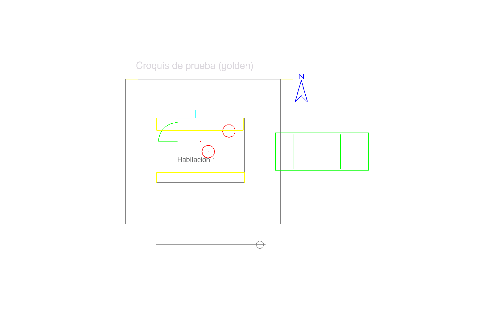

# Verificación del DXF en visores CAD

Criterio H4-2 del Jot Down y CA-06 de la especificación (REQ-12): el DXF exportado abre sin
errores en FreeCAD (verificación manual por hito, con captura anexa al PR) y en LibreCAD y QCAD
en CI con `xvfb` donde sea viable. La comprobación automática con ezdxf (`audit()`, relectura,
conteo por capa y coordenadas, H4-1) vive en los tests de `sketch2cad-api/tests/export/`.

Todos los comandos se ejecutan desde `sketch2cad-api/`.

## Archivo de referencia (golden)

`tests/golden/plan.dxf` es la exportación en modo **final** de una revisión ficticia
(`golden_snapshot()` en `tests/export/test_golden_dxf.py`, `frozen_at` fijo
2026-10-21T09:30:15.123456Z, escala de papel 1:100). Contiene todos los tipos de entidad del
exportador:

| Capa | Contenido | Entidades DXF |
|---|---|---|
| `L_STRUCTURE` | dos líneas y una polilínea cerrada | 2 `LINE`, 1 `LWPOLYLINE` |
| `L_ACCESS` | polilínea abierta | 1 `LWPOLYLINE` |
| `L_EVIDENCE` | dos puntos simples, un punto de indicio (n.º 1, «Casquillo») con su marcador y un símbolo `evidence_marker` n.º 2 | 3 `POINT`, 2 `INSERT` con `ATTRIB` |
| `L_SYMBOLS` | puerta y vehículo genérico (atributo `LABEL` = `V1`) | 2 `INSERT` |
| `L_DIMENSIONS` | cotas declarada coincidente (`4.20`), declarada dentro de tolerancia (`4.24` sobre 4,25 m), sin declarar (`7.00`) y discrepante (`6.50` sobre 7 m, estilo rojo `S2C_DIM_ALERT`) | 4 `DIMENSION` |
| `L_TEXT` | «Habitación 1» (texto no ASCII) | 1 `TEXT` |
| `L_ORIENTATION` | flecha de norte | 1 `INSERT` |
| `L_ANNOTATIONS` | «Croquis de prueba (golden)» | 1 `TEXT` |
| `L_CONTROL` | punto, símbolo de control y **segmento de control de 5,000 m** | 1 `POINT`, 1 `LINE`, 1 `INSERT` |
| `L_SHEET` | punto invisible con los metadatos (XDATA `SKETCH2CAD`); sin marca de agua (modo final) | 1 `POINT` |

`test_golden_dxf.py` regenera el archivo y exige igualdad byte a byte con el archivo versionado
y con su SHA-256 (`GOLDEN_SHA256`). Si el cambio del exportador es intencionado:

```bash
uv run python scripts/regenerate_golden_dxf.py   # reescribe el archivo e imprime el SHA-256
```

Se copia el hash impreso en `GOLDEN_SHA256` y se repite la verificación en FreeCAD de este
documento.

Fechas: `ezdxf.read()` (y cualquier visor que reescriba la cabecera) muestra en `$TDCREATE` la
hora de lectura, no la de la revisión. La fecha real está en los bytes del archivo: en el
golden, `$TDCREATE` = `2461335.3960069446` (fecha juliana de `frozen_at`).

## FreeCAD: lista de verificación manual (por hito)

Visor de referencia del propietario (decisión de 2026-10-24). Se repite en cada hito con el
`plan.dxf` de un paquete real o con el golden, y la captura se adjunta al PR del hito.

### Preparación

1. FreeCAD 1.1 o posterior. En *Editar > Preferencias > Importar/Exportar > DXF*: importador
   nuevo (no el heredado), activadas las opciones de importar textos y cotas («Import texts
   and dimensions»), usar capas («Use layers») y colores del DXF («Use colors from the DXF
   file»), y modo «Individual part shapes» (piezas individuales, el modo por defecto). No usar el modo «Objetos Draft editables»: en FreeCAD 1.1.4
   aborta el posproceso con este archivo (`'FeaturePython' object has no attribute
   'Placement'`) y deja objetos sin capa.
2. *Archivo > Abrir* `plan.dxf`. Vista superior (tecla `2`) y *Ajustar todo* (`V`, `F`).
3. Abrir la *Vista de informe* para leer el resumen de importación.

### Qué revisar

- [ ] El resumen de importación dice `File units: Meters (from $INSUNITS)` y
      `1 DXF unit = 1000.0000 mm`, sin errores de lectura.
- [ ] Existen las capas `L_STRUCTURE`, `L_ACCESS`, `L_EVIDENCE`, `L_SYMBOLS`, `L_DIMENSIONS`,
      `L_TEXT`, `L_ORIENTATION`, `L_ANNOTATIONS`, `L_CONTROL` y `L_SHEET`, y cada objeto está
      en su capa (árbol del documento).
- [ ] Colores por capa (ACI): estructura 7 (negro/blanco), accesos 4 (cian), indicios 1 (rojo),
      símbolos 3 (verde), cotas 2 (amarillo), orientación 5 (azul), control 8 (gris).
- [ ] El texto «Habitación 1» se lee con su tilde.
- [ ] Los símbolos llegan como instancias de bloque (`App::Link` a `BLOCK_S2C_<símbolo>`), con
      su tamaño y giro: puerta con su arco, vehículo, norte con «N», marcadores de indicio.
- [ ] El segmento de `L_CONTROL` mide **5000 mm** (*Medir* o propiedades de la arista): el
      archivo está en metros y FreeCAD lo escala ×1000.
- [ ] Las cotas existen en `L_DIMENSIONS` y miden la geometría real (ver limitaciones: FreeCAD
      no muestra el texto declarado `4.20`).
- [ ] Modo final: no hay marca de agua. En un borrador, `L_SHEET` tiene el texto
      `DRAFT — NOT VALIDATED`.

### Versión automatizada (sin tocar las preferencias del usuario)

`scripts/freecad_check_dxf.py` hace la misma importación con el intérprete de FreeCAD, cuenta
los objetos por capa y tipo, lista textos y cotas, mide el segmento de control y termina con
estado 0 si hay objetos y el segmento mide 5000 mm (±0,01 mm); 1 si no; 2 si falta el archivo.
`-u`/`-s` apuntan a archivos de preferencias temporales, de modo que las preferencias de
importación que fija el script no llegan al `user.cfg` del usuario:

```bash
FC=/Applications/FreeCAD.app/Contents/Resources/bin   # macOS; en Linux, freecadcmd del PATH
CFG=$(mktemp -d)
"$FC/freecadcmd" -u "$CFG/user.cfg" -s "$CFG/system.cfg" \
    scripts/freecad_check_dxf.py --pass tests/golden/plan.dxf "$CFG/report.json"
```

Captura con la interfaz gráfica (abre una ventana unos segundos y se cierra sola; necesita
pantalla, en Linux sirve `xvfb-run`). El estado de salida del binario gráfico no es el resultado:
se lee el JSON. En macOS el lanzador `FreeCAD.app/Contents/MacOS/FreeCAD` imprime todas las
variables de entorno al arrancar: no pegar esa salida en el PR (puede contener tokens).

```bash
/Applications/FreeCAD.app/Contents/MacOS/FreeCAD -u "$CFG/user.cfg" -s "$CFG/system.cfg" \
    "$PWD/scripts/freecad_check_dxf.py" --pass "$PWD/tests/golden/plan.dxf" \
    "$CFG/report.json" "$CFG/captura.png"
```

## Resultado del 2026-10-26

**FreeCAD 1.1.4** (revisión `20260928 (Git shallow)`, commit `4fd3bf320`), macOS arm64,
golden con SHA-256 `99d1a45f9e40de0023eb459b8113f16f4ba9ca91caab14646b4f35949abd04b4`.
Ejecutado con `freecadcmd` (sin interfaz) y con el binario gráfico para la captura; ambos
informes coinciden salvo las propiedades de vista, que solo existen con interfaz.

Resumen de importación de FreeCAD: `File units: Meters (from $INSUNITS)`,
`Final scaling: 1 DXF unit = 1000.0000 mm`, 57 entidades leídas, 39 objetos creados, sin
errores. Entidades no soportadas por el importador: `ATTDEF` (3), `ATTRIB` (5), `SEQEND` (3) y
`SOLID` (1, dentro de la definición de bloque de flecha `_CLOSEDFILLED` que ezdxf añade al
documento).

| Capa | Entidades en el DXF | Objetos en FreeCAD |
|---|---|---|
| `L_STRUCTURE` | 3 | 3 `Part::Feature` |
| `L_ACCESS` | 1 | 1 `Part::Feature` |
| `L_EVIDENCE` | 5 | 3 `Part::Feature` (puntos) + 2 `App::Link` (marcadores) |
| `L_SYMBOLS` | 2 | 2 `App::Link` |
| `L_DIMENSIONS` | 4 | 4 cotas Draft (`LinearDimension`) |
| `L_TEXT` | 1 | 1 texto Draft |
| `L_ORIENTATION` | 1 | 1 `App::Link` |
| `L_ANNOTATIONS` | 1 | 1 texto Draft |
| `L_CONTROL` | 3 | 2 `Part::Feature` + 1 `App::Link` |
| `L_SHEET` | 1 (metadatos) | 1 `Part::Feature` |

Fuera de capas quedan las definiciones de bloque (8 `Part::Compound` y sus 15 formas) y los
grupos `_BlockDefinitions` / `_UnreferencedBlocks`.

Observado:

- Abre sin errores; las 10 capas del catálogo (más `0` y `Defpoints`) y el número de objetos
  por capa coinciden con el DXF.
- Unidades correctas: el segmento de control mide 5000,0 mm; las cotas miden 4250, 4200, 7000
  y 7000 mm, igual que la geometría.
- Textos «Habitación 1» y «Croquis de prueba (golden)» legibles, con tilde.
- Símbolos como instancias de bloque con tamaño, giro y color de capa correctos (puerta,
  vehículo, norte, marcadores, punto de control).
- Colores de capa respetados en líneas y símbolos; el texto de `L_ANNOTATIONS` se ve gris
  claro en lugar de magenta (ACI 6).
- En un borrador del mismo snapshot, el texto `DRAFT — NOT VALIDATED` aparece en `L_SHEET`; en
  el golden (final) no.

Limitaciones de FreeCAD 1.1.4 con este DXF (son del visor; el archivo pasa `audit()` y ezdxf
lo relee completo):

- **Atributos de bloque**: `ATTRIB`/`ATTDEF` no se importan. El marcador de indicio se ve como
  un círculo **sin número** y el `LABEL` del vehículo no aparece. El número sí está en el DXF
  (`EVIDENCE_NUMBER`, comprobado por `test_golden_dxf.py`) y en el PDF.
- **Texto de las cotas**: FreeCAD crea cotas Draft que muestran su propia medida
  (`4200.00 mm`, `4250.00 mm`, `7000.00 mm`) y no el texto del DXF (`4.20`, `4.24`, `6.50`,
  `7.00`): `OverrideText` queda vacío. Tampoco conserva el estilo rojo de la cota discrepante
  ni las marcas `ARCHTICK`. Además, con el tamaño de letra por defecto de FreeCAD (3,5 mm, en un
  dibujo de varios metros) el texto de cota no se ve sin acercar mucho la vista.
- El modo de importación «Objetos Draft editables» falla en el posproceso (ver Preparación).

Captura (interfaz gráfica, vista superior, fondo blanco):


Preferencias: esta ejecución usó archivos de preferencias temporales (`-u`/`-s`) y no modificó
`~/Library/Preferences/FreeCAD/v1-1/user.cfg` (comprobado por suma MD5 antes y después). El
spike 2 sí editó ese archivo temporalmente y lo restauró.

## LibreCAD y QCAD (CI con xvfb)

Ninguno de los dos está instalado en el equipo de desarrollo (macOS, sin `xvfb-run`), así que no
se han abierto todavía.

`scripts/open_dxf_xvfb.sh FILE.dxf` abre el archivo con `librecad dxf2pdf` (LibreCAD 2.2 o
posterior) dentro de `xvfb-run` y con `timeout` (60 s, variable `DXF_VIEWER_TIMEOUT`). Estados
de salida:

| Estado | Significado |
|---|---|
| 0 | LibreCAD terminó bien y escribió un PDF no vacío; o falta una herramienta y se imprime `SKIP: ...` |
| 1 | LibreCAD falló, se colgó, superó el tiempo o no escribió el PDF |
| 2 | Uso incorrecto o el DXF no existe |
| 3 | Falta una herramienta y `DXF_VIEWER_REQUIRED=1` |

Sin las herramientas el script sale con 0 y `SKIP` para no romper ejecuciones locales ni CI
donde no existen; el job de CI fija `DXF_VIEWER_REQUIRED=1` para que una instalación fallida no
pase en verde. Resultado en este equipo: `SKIP: missing librecad xvfb-run timeout; the DXF was
not opened`, estado 0. `tests/test_open_dxf_xvfb.py` comprueba la sintaxis (`bash -n`) y todos
los estados con herramientas simuladas.

El script solo demuestra que LibreCAD lee y dibuja el archivo sin fallar; no compara lo
dibujado. Para mirarlo, se abre el PDF generado o el DXF en la interfaz.

En Linux (Debian/Ubuntu):

```bash
sudo apt-get install librecad xvfb xauth
DXF_VIEWER_REQUIRED=1 bash scripts/open_dxf_xvfb.sh tests/golden/plan.dxf
```

QCAD (Community Edition) no tiene script: según la documentación de QCAD, las herramientas de
línea de órdenes para convertir a PDF/PNG (`dwg2pdf`, `dwg2bmp`) son de QCAD Professional (no
comprobado aquí). Verificación manual: `xvfb-run qcad tests/golden/plan.dxf`
solo comprueba que no se cae al arrancar; mejor abrirlo con pantalla y revisar la misma lista
que en FreeCAD.

### Job de CI deshabilitado

`.github/workflows/dxf-viewers.yml` define el job `librecad` (instala `librecad`, `xvfb` y
`xauth` en `ubuntu-latest` y ejecuta el script con `DXF_VIEWER_REQUIRED=1`), solo con
disparo manual (`workflow_dispatch`) y **deshabilitado** con `if: false`. Motivo: la apertura
sin pantalla no se ha probado nunca en un runner de GitHub (no hay LibreCAD ni Linux con xvfb
aquí), no se ha comprobado que el paquete de Ubuntu traiga la orden `dxf2pdf` y la verificación
obligatoria de H4-2 es la manual en FreeCAD. Para habilitarlo: quitar `if: false`, lanzarlo a
mano desde *Actions* y, si pasa de forma estable, añadir un disparador `pull_request` sobre
`sketch2cad-api/src/sketch2cad/export/**` y `tests/golden/**`. Si falla por el visor (no por
el archivo), se documenta aquí y se deja deshabilitado.

## Limitaciones conocidas de los visores

- FreeCAD no importa atributos de bloque ni el texto de las cotas (ver arriba); QCAD y LibreCAD
  soportan `ATTRIB` y texto de cota, pero no se han comprobado.
- Los visores recalculan `$TDCREATE`/`$TDUPDATE` al guardar: no guardar el DXF desde el visor
  si se va a comparar su hash con el manifiesto.
- `SOLID` no se importa en FreeCAD. El único del golden está en la definición de bloque
  `_CLOSEDFILLED` (flecha rellena por defecto de ezdxf), que las cotas no usan: emplean
  `_ARCHTICK`, y FreeCAD tampoco dibuja esas marcas.
